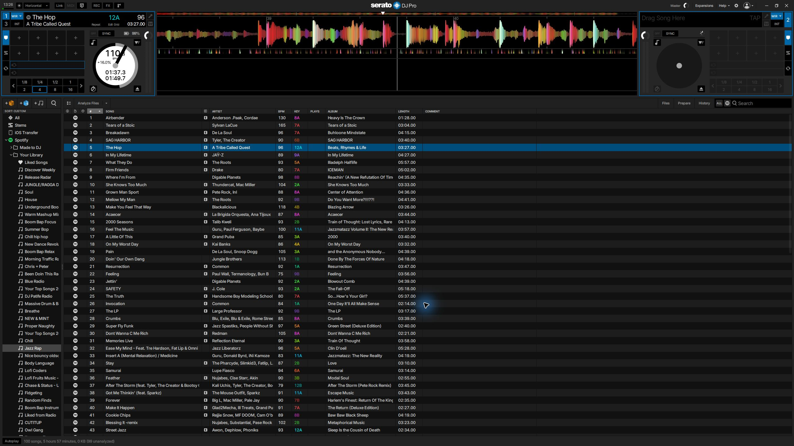
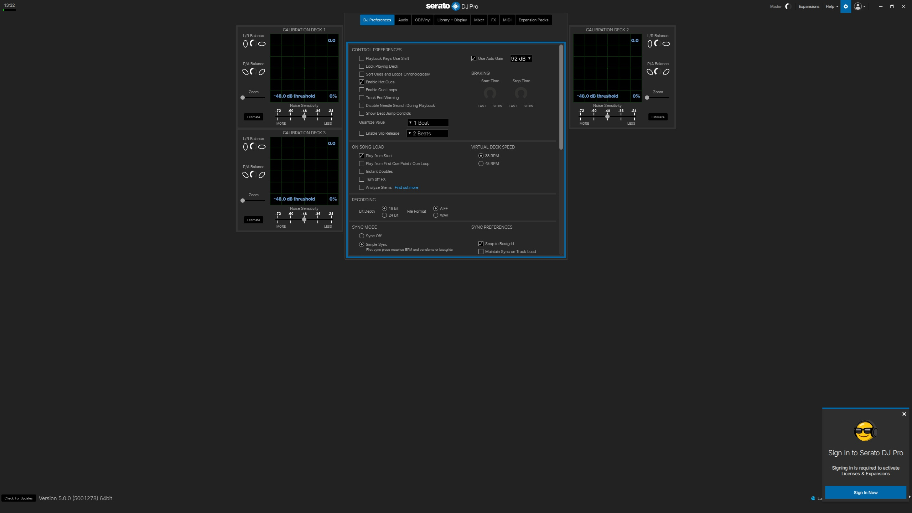

# Serato 5.0 and Phase Essential demonstration

5 November 2026. The Windows 11 test setup uses the rebuilt SL3 ASIO driver with Serato DJ Pro 5.0.0.1278 and Phase Essential.

## Phone video

[Watch or download the phone video](media/2026-11-05/vid_phase_sl3_serato_5.0.mp4)

The 13-second clip shows the physical Phase/turntable and SL3 setup, followed by Serato playing a track on the monitor.

## Working deck

The screenshot shows Phase's WIR mode and a loaded Spotify track.

[Open the full-resolution working screenshot](media/2026-11-05/serato-5-sl3-phase-20261105.jpg)

## Version

The bottom-left corner shows Version 5.0.0 (5001278) 64bit.

[Open the full-resolution version screenshot](media/2026-11-05/version.jpg)

## Development progress

Serato has selected the genuine SL3, opened the rebuilt ASIO driver and successfully started 44.1 kHz audio with 128-frame buffers. Phase input was measured on channels 3/4, and the owner separately confirmed one-deck REL tracking in a manual test with the tracer detached. The working-deck image above documents WIR mode.

The setup currently uses a temporary descriptor and installer integration with a bounded diagnostic broker. Audible SL3 output, sustained reliability, the second deck and a reusable installation/startup flow remain validation targets. The [Phase status](phase-essential-status.md) and [return report](RETURN-REPORT.md) contain the evidence and remaining work.

The media files are published unchanged from the owner's supplied files.
