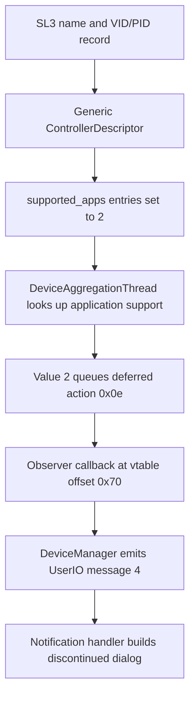

# Serato 5.0.0 SL3 discontinued path

Target: Windows x64 5.0.0.1278, SHA-256 `66e7af01ddfd151814f51bf44bd8472e5c94f54b3ce12119ef70b7cbab433265`. All addresses are preferred image VAs. These are static findings, correlated with the already observed “Rane SL3 Discontinued” panel. No executable was modified.

## Recovered path

| Stage | Evidence |
| --- | --- |
| Identity | `0x140503a40` builds `Rane SL3`, VID 0x1CC5 / PID 1; caller at `0x140504a63` invokes `0x1405d02e0` for records in this list |
| Descriptor | `0x1405d02e0` calls allocator/factory `0x1405ce730`; constructor `0x1405bead0` installs RTTI-resolved `serato::dj::ControllerDescriptor` tables |
| Fields | Helper writes VID/PID at object offsets 0xA8 / 0xAA, and names at 0x28 / 0x48 |
| Application map | Helper sets both `Serato DJ Lite` and `Serato DJ` map values to 2 at map offset 0x5F8, via node-value offset 0x40; stores follow calls at `0x1405d0437` and `0x1405d0458` |
| Map getter | Descriptor interface subobject is at +0x10. Its vtable `0x14281caf0`, slot +0x38, points to leaf `0x1405c6a60`, which returns `this + 0x5e8`, i.e. complete-object +0x5F8 |
| Support lookup | `0x1421db390` obtains a descriptor through `0x140c00570`, invokes slot +0x38 at `0x1421db6b0`, and searches the map using its application-name member at +0x68 |
| Branch | `0x1421db822` compares the support value with 2; `0x1421db845` selects action 0x0E and calls constructor `0x1421de6b0` at `0x1421db887`. Support 0 selects action 0x0D; support 1 proceeds into a different connection-initialization branch |
| Queue | `0x1421db970` calls `0x1421de0a0`, which queues the deferred action and signals its worker |
| Action | RTTI identifies `DispatchDeviceDeferredAction`. Execute `0x1421de890` dispatches case 0x0E through observer slot +0x70 at `0x1421deb77` |
| Observer implementation | `DeviceManager` RTTI locates observer vtable `0x1431c3f28`, complete-object offset +0x88. Slot +0x70 is `0x14213f290`, which schedules callback `0x14213f330` through `0x14213ae20` |
| UserIO message | `0x14213f330` obtains two descriptor strings and calls `0x14059c190` with message type **4** and their pair |
| UI | Handler `0x14137b790`, case 4, casts the pair payload, diagnoses failure with `failed cast for kDiscontinuedDevice`, and calls `0x14137d800` |
| Dialog | `0x14137d800` uses `DeviceDiscontinued`, `id-device-discontinued-notification-title` and the matching paragraph resource, substituting the device strings |

This identifies a support-state mechanism and its notification route. The generic helper is not an SL3 audio initializer: no Rane DLL load, legacy control-export resolution or stream/DVS setup appears in that helper. Other generic/backend code is not excluded by this observation.

## Evidence and limits

- `evidence/serato500-discontinued-path.json`: selected Ghidra decompilations; the large selector and notification handler are explicitly projected to relevant branches.
- `evidence/serato500-support-branch-assembly.json`: selected machine-code excerpts for the support writes, map getter, branch and dispatch.
- `evidence/serato500-controller-rtti.json` and `serato500-device-manager-rtti.json`: validated MSVC complete-object locators, interface offsets and vtable candidates.
- Full intermediate reports, constructor output and Ghidra project are retained under ignored `analysis/` for continuing work.

The support-map lookup, deferred-action layout and concrete observer implementation are statically established. A debugger trace has not verified the exact instantiated observer and object lifetime on this run. The observed UI is consistent with this chain; do not describe static analysis as a captured call trace.

The previous unresolved query `0x140502ae0` is now decoded: it tests the first qword for null (`cmp [rcx],0; sete al; ret`). It is a shared-pointer emptiness check, not an identified capability or authentication check. The object at `0x1405d2180` is RTTI-identified as `AvailablePadModeController`; it must not be mislabeled the USB discovery agent.

## Consequence for implementation

Changing support 2 to 1 would enter another branch, but does not demonstrate populated SL3 capabilities, an opened transport, channel mapping, routing or DVS. The original seven-export Rane interface remains visible in 2.5.5 and 2.5.6; an equivalent current integration has not been located. No support-state patch is applied.

The next application experiment is to trace the support-1 path's descriptor, audio-driver and capability requirements, then determine which of them the SL3 stub lacks. Compare historical registration/dispatch in 2.5.5 and 2.5.6 separately; their loader's presence alone does not settle the original support cutoff.

That investigation now establishes empty MIDI/audio-name defaults, a true legacy-audio flag, a separate registry-based DriverAPI readiness path, and a retained generic ASIO backend with an initial start/stop probe. [Supported-device contract and remaining integration gaps](serato-supported-contract.md). No support-state edit or audio/DVS success is claimed.
